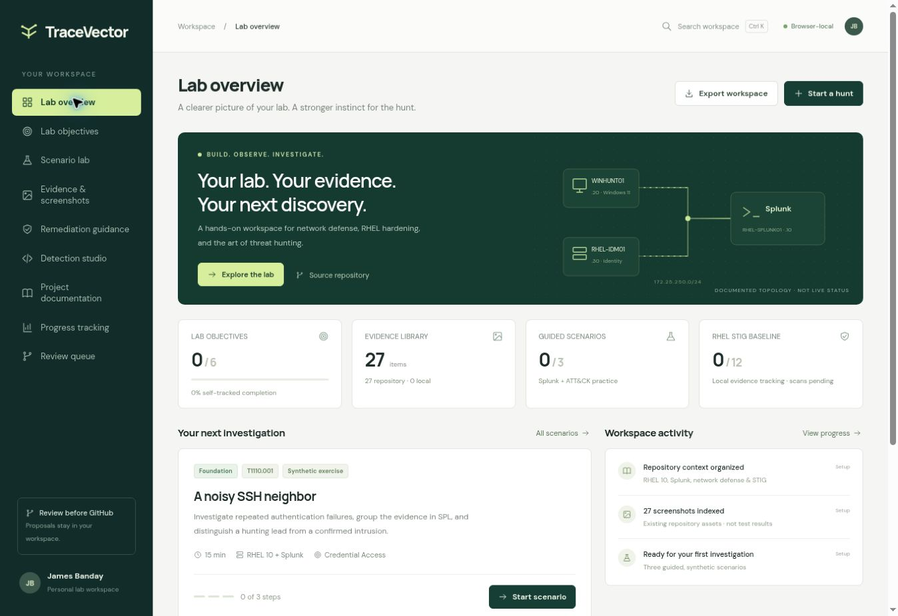

# RHEL 10.2 Splunk Threat Hunting Lab

This VMware lab combines Splunk Enterprise on RHEL 10.2, a Windows 11 endpoint, and Red Hat IdM for security monitoring and threat-hunting exercises. The repository contains procedures and configuration examples. Optional network sensors, STIG assessments, and other extensions remain work in progress; published files do not prove a live deployment or completed assessment.

## Start here

| Goal | Guide |
| --- | --- |
| Work in VS Code and WSL | [WSL quick start](start-here/START_HERE_WSL.md) · [Publishing guide](docs/reference/WSL_VSCODE_GITHUB_UPLOAD_GUIDE.md) |
| Build the core lab | [RHEL and Splunk](start-here/START_HERE_RHEL10v2.md) · [Windows alternative](start-here/START_HERE_WINDOWS.md) |
| Assess Windows 11 | [Windows 11 STIG V2R11](start-here/START_HERE_WINDOWS11_STIG.md) |
| Assess Windows Firewall | [Defender Firewall STIG V2R2](start-here/START_HERE_WINDOWS_FIREWALL_STIG.md) |
| Analyze network activity | [Kali workstation setup](docs/network-defense/KALI_DEPLOYMENT.md) · [Passive network defense](start-here/START_HERE_NETWORK_DEFENSE.md) · [Arkime sensor](start-here/START_HERE_ARKIME.md) |

[Browse the current start guides](start-here/README.md).

## TraceVector · Threat Hunting Lab

[Open the private TraceVector Site](https://tracevector-lab.jamesbanday.chatgpt.site) · [Start a guided hunt](https://tracevector-lab.jamesbanday.chatgpt.site/#scenarios) · [Guide and nine screenshots](docs/network-defense/INTERACTIVE_LAB.md) · [Current source](website/tracevector-lab/)

TraceVector brings guided Splunk hunts and MITRE ATT&CK context together with evidence and documentation tracking, STIG guidance, detection drafts, progress tracking, and a review queue. Its nine sections include six learning objectives, three synthetic investigations, and twelve RHEL STIG evidence requirements. The hosted Site requires the owner’s ChatGPT sign-in; repository visitors can view the matching source and screenshots here.

Progress, notes, drafts, and evidence attachments save in the current browser, with backup export/import. Review decisions are local records; applying a proposal to GitHub is a separate reviewed action. Training results and checklist completion do not establish live detection coverage or STIG compliance.

[](docs/network-defense/INTERACTIVE_LAB.md)

*Figure 1: The TraceVector dashboard brings lab topology, guided hunts, evidence, and progress into one personal workspace.*

The [earlier network-defense workbench](website/network-defense-lab/) remains available for architecture, analysis-tool references, traffic paths, deployment phases, and its original ten-check validation workflow.

## Project documentation

- [Complete 52-step deployment index](docs/steps/README.md) · [Full Markdown guide](docs/reference/RHEL_10_2_Splunk_Complete_Guide_with_LDAP.md) · [Word guide](docs/reference/RHEL_10_2_Splunk_Complete_Guide_with_LDAP.docx)
- [Optional appendices](docs/appendices/README.md) · [Reference files](docs/reference/README.md) · [Software downloads](docs/reference/downloads.md) · [Deployment order](docs/reference/deployment-order.md)
- [MITRE ATT&CK hunting](docs/mitre-attack/README.md) · [Cobalt Strike-associated hunt and safe Atomic validation](hunts/cobalt-strike/COBALT_STRIKE_ATOMIC_VALIDATION.md)
- [Kali Wireshark, Zeek, Suricata, Arkime, YARA and Sigma setup](docs/network-defense/KALI_DEPLOYMENT.md) · [Network defense](docs/network-defense/README.md) · [Complete RHEL Zeek deployment](docs/network-defense/ZEEK_DEPLOYMENT.md) · [RHEL Arkime installation and investigation](docs/arkime/IMPLEMENTATION_GUIDE.md)
- [Incident management, hunt reports, and AI-assisted forensic review](docs/security-operations/README.md)
- [Weekly APT threat hunting guides](docs/security-operations/weekly-threat-hunting/README.md) · [Six-phase incident response, roles, escalation, mitigations and prevention](docs/security-operations/APT_INCIDENT_RESPONSE_PLAYBOOK.md)
- [IdM setup troubleshooting](docs/troubleshooting/idm-installation-and-dns.md) · [Windows forwarding troubleshooting](docs/troubleshooting/splunk-forwarder-tls-and-kv-service.md) · [Windows test-account troubleshooting](docs/troubleshooting/windows-powershell-cmd-credentials.md)

## NIST AI RMF and security governance (proposed extension)

The [NIST AI RMF implementation guide](docs/ai-rmf/IMPLEMENTATION_GUIDE.md) and [AI risk governance documentation](docs/ai-rmf/README.md) describe an **optional future, read-only, human-reviewed AI-assisted Splunk alert summarizer**. This is a **Work in Progress**: no model is deployed, no AI test outcomes are asserted, and no security categorization or Authorization to Operate is granted. The documentation connects AI RMF `GOVERN/MAP/MEASURE/MANAGE` with SP 800-37 `PREPARE/CATEGORIZE/SELECT/IMPLEMENT/ASSESS/AUTHORIZE/MONITOR` and illustrative SP 800-53 controls.

## Lab systems

| System | Role |
| --- | --- |
| RHEL-SPLUNK01 | Splunk Enterprise, security searches, and TLS receiver |
| WINHUNT01 | Windows event collection, Sysmon, and Universal Forwarder |
| RHEL-IDM01 | IdM directory, DNS, and LDAPS |
| Kali Linux analysis VM (optional) | Offline Wireshark, Zeek, Suricata, Arkime, YARA, and Sigma exercises; unique VMnet8 DHCP lease |
| RHEL-SENSOR01 (optional; not installed) | Proposed passive network sensor and Arkime exercises |

The core Splunk indexes are `win_security`, `win_system`, `powershell`, `sysmon`, `linux`, and `lab`. Kali's offline outputs and the optional sensor do not automatically send Arkime sessions or network logs to Splunk. [Step 28.16](docs/steps/28-generate-harmless-hunting-activity.md#step-2816--optional-kali-linux-analysis-workstation) joins the Kali procedure to the 52-step path.

## Repository layout

| Folder | Contents |
| --- | --- |
| [start-here](start-here/README.md) | Current quick-start and workstream guides |
| [docs](docs/steps/README.md) | Detailed steps, appendices, STIGs, network and security-operations guides |
| [docs/reference](docs/reference/README.md) | Complete guide, architecture, templates, configuration examples, and publication notes |
| [apps](apps/) and [configs](configs/) | Splunk apps and reviewed configuration examples |
| [website/tracevector-lab](website/tracevector-lab/) | Published source snapshot for the current private TraceVector workspace |
| [website/network-defense-lab](website/network-defense-lab/) | Earlier network-defense reference workbench and its original screenshot gallery |
| [hunts](hunts/), [rules](rules/), and [scripts](scripts/) | Searches, detection examples, and lab helpers |
| [evidence/sanitized](evidence/sanitized/) and [screenshots](screenshots/) | Pending result templates and author-supplied images that require review |

## Validate and publish

From the repository root on RHEL or WSL, run:

```bash
python3 scripts/validate_project.py
python3 -B -m unittest discover -s tests -v
python3 tools/publication_preflight.py
```

These are source checks. Record live results in [sanitized validation templates](evidence/sanitized/validation.md) only after observing them. The historical `FILE_MANIFEST.json` describes the original ZIP, so its `--verify-manifest` mode applies to that unchanged package, not the reorganized checkout. Review [public repository safety](docs/reference/security-and-sanitization.md) and [SECURITY.md](SECURITY.md) before publishing screenshots or evidence. Never publish secrets.
