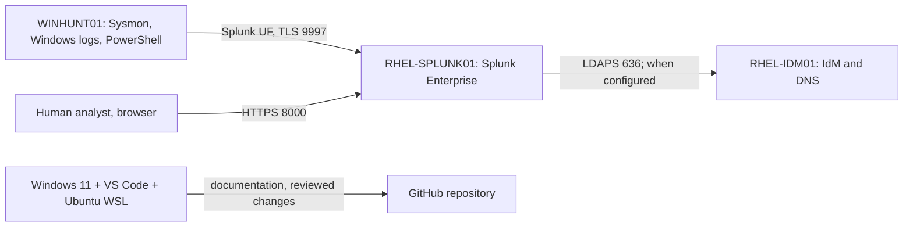
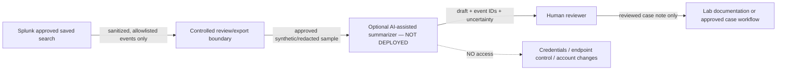

# 02 — System Boundary and Data Flow

## Current environment (documented lab; test status varies by component)



This is the lab's **documented intended architecture**. The diagram does not certify that LDAPS, data ingestion, or an alert is currently functioning.

## Proposed future AI extension — not deployed



## Trust and information boundaries

1. **Collection boundary:** Windows and Linux logs enter Splunk through existing lab paths.
2. **Export boundary:** Only explicitly approved fields can leave a saved search; default deny for free-text raw event bodies.
3. **AI processing boundary:** The provider, location, retention, version, and access rules remain **TBD**; network connectivity is disabled until assessed and approved.
4. **Human decision boundary:** AI-generated summaries cannot execute searches with broader rights, change Splunk configuration, create accounts, isolate hosts, or trigger response actions.
5. **Evidence boundary:** GitHub receives only sanitized screenshots, templates, synthetic test cases, and non-sensitive findings.

## Candidate allowlist (illustrative, adjust after review)

```text
event_id
source_system (generalized)
event_type
timestamp_utc (synthetic examples only)
sanitized_action
detection_rule_id
```

Exclude by default: passwords, authentication tokens, private IPs when disclosure is prohibited, host/user identifiers not approved for export, protected records, raw command lines containing sensitive values, and full event payloads.

## Decision gates

- AI model chosen? **No.**
- Approved data categories? **Pending.**
- External provider approved? **Pending.**
- Human-in-the-loop design approved? **Pending.**
- Network or API integrations deployed? **No.**
