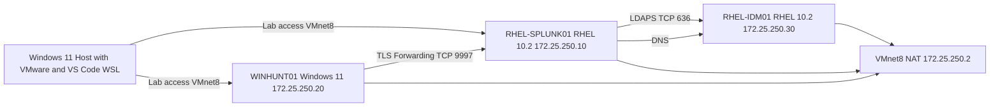

# VMware Splunk Threat Hunting Lab architecture

The diagram shows the **planned** connections; verify actual flows in your VMs.

Splunk Web uses HTTPS TCP 8000. Windows sends logs using the Universal Forwarder; Sysmon produces endpoint telemetry. RHEL IdM provides identity and verified LDAPS access. A GitHub-hosted Actions runner does not directly reach this private VMware subnet.
