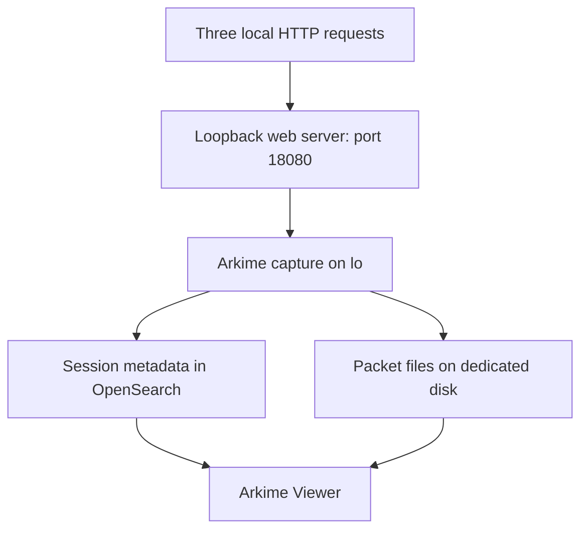

# Arkime — Controlled Live Capture Test on the Sensor

Use this optional test after [Steps 1–31 of the installation guide](IMPLEMENTATION_GUIDE.md). It generates three harmless HTTP requests on the sensor and captures only that local test port. This checks the path from a live interface to saved sessions and packet reconstruction without needing a VMware mirror.

**Status:** procedure provided; Arkime capture has not been validated in the user's VM. Record actual results in the [validation template](../../evidence/sanitized/arkime-validation.md). This test uses generated text on loopback and is compatible with the installation guide's synthetic-only database scope. Capturing an external network still requires the separate deployment procedure.

## Step 1 — Understand the test path



The client uses `curl --resolve` to associate the two example hostnames with `127.0.0.1` for these requests only. It does not update system DNS or generate DNS traffic. The HTTP host header changes while the destination address and download path stay the same.

Use three Bash terminals on **RHEL-SENSOR01**, plus the existing SSH-tunneled Viewer in your Windows browser. Label the terminals A, B and C so the server and capture remain visible while the requests run.

## Step 2 — Verify prerequisites

In terminal B:

```bash
systemctl is-active opensearch
systemctl is-active arkimeviewer
systemctl is-active arkimecapture
pgrep -x capture
ss -lnt '( sport = :18080 )'
```

**Command overview:** `is-active` checks services, `pgrep` looks for another capture process, and `ss` checks the test port. Expect OpenSearch and Viewer to be active, the live capture service to be inactive, no other `capture` process, and no listener on port `18080`. The inactive service and absent process produce nonzero exit codes; these are expected checks. Stop if another capture or port owner exists and review it before continuing.

Verify both data mounts and their space:

```bash
mountpoint /srv/arkime-opensearch
mountpoint /srv/arkime-pcap
df -hT /srv/arkime-opensearch /srv/arkime-pcap
```

**Expected:** both dedicated filesystems are mounted with adequate free capacity. Keep the local database endpoint and restricted configuration from the installation guide. Do not print `config.ini`, because it contains the database credential.

## Step 3 — Create a private, minimal HTTP document root

In terminal A, as your normal lab administrator:

```bash
umask 077
mkdir -p "$HOME/arkime-lab"
ARKIME_LIVE_WEB_ROOT=$(mktemp -d "$HOME/arkime-lab/local-http-XXXXXXXX")
mkdir "$ARKIME_LIVE_WEB_ROOT/downloads"
printf '%s\n' 'ARKIME-LOCAL-STATUS' > "$ARKIME_LIVE_WEB_ROOT/status.txt"
printf '%s\n' 'ARKIME-LOCAL-CONTROL' > "$ARKIME_LIVE_WEB_ROOT/downloads/review.txt"
python3 -m http.server 18080 --bind 127.0.0.1 --directory "$ARKIME_LIVE_WEB_ROOT"
```

**Command overview:** `mktemp` creates a new private directory; `printf` writes two inert text files. Python serves only that directory on loopback. Leave this foreground server running. Confirm its message names `127.0.0.1` and port `18080`; do not bind it to all interfaces or serve your home directory or repository.

## Step 4 — Start a bounded Arkime capture

In terminal B, run the entire block. It checks the mounts, avoids a second capture process, and runs a foreground capture for at most two minutes. The settings are command-line overrides for this test and do not edit the service configuration.

```bash
(
  set -eu
  mountpoint -q /srv/arkime-opensearch
  mountpoint -q /srv/arkime-pcap
  if systemctl is-active --quiet arkimecapture || pgrep -x capture >/dev/null; then
    echo 'STOP: Another capture process or service is active' >&2
    exit 1
  fi
  sudo env no_proxy=arkime-db.lab.test,localhost,127.0.0.1 \
    NO_PROXY=arkime-db.lab.test,localhost,127.0.0.1 \
    timeout --signal=INT --kill-after=15s 120s \
    /opt/arkime/bin/capture -c /opt/arkime/etc/config.ini \
    -o interface=lo -o pcapReadMethod=libpcap \
    -o 'bpf=tcp port 18080 and host 127.0.0.1' \
    -t arkime-local-control
)
```

| Command or option | Explanation |
| --- | --- |
| `( ... )` | Runs the test in its own shell, so its error handling does not close your terminal. |
| `set -eu` | Stops that shell on an error or an unset variable. |
| `sudo env` | Runs the capture with privileges needed to open the interface and excludes the local database from proxies. |
| `timeout --signal=INT ... 120s` | Sends a normal interrupt after two minutes. |
| `--kill-after=15s` | Forces exit if the process does not stop within the following 15 seconds. |
| `-c` | Uses the private configuration already validated in the installation guide. |
| `-o interface=lo` | Selects loopback for this one invocation. |
| `-o pcapReadMethod=libpcap` | Uses Arkime's supported libpcap reader for the small local test. |
| `-o bpf=...` | Restricts capture to TCP port 18080 and IPv4 loopback. |
| `-t arkime-local-control` | Tags the new sessions so you can distinguish them from offline imports. |

**Expected:** capture starts without interface, permission, storage or database errors. Wait for startup before sending requests. This uses the single-node configuration from the main guide; review any node-specific overrides first. Do not use `--debug` or dump the configuration to troubleshoot credentials.

## Step 5 — Generate two routine requests

In terminal C, after capture has started:

```bash
date -u '+Start: %Y-%m-%dT%H:%M:%SZ'
curl --fail --silent --show-error --noproxy '*' --max-time 10 \
  --resolve updates.example.test:18080:127.0.0.1 \
  http://updates.example.test:18080/status.txt
curl --fail --silent --show-error --noproxy '*' --max-time 10 \
  --resolve updates.example.test:18080:127.0.0.1 \
  http://updates.example.test:18080/downloads/review.txt
```

**Command overview:** `--resolve` supplies the address for this hostname and port; `--noproxy '*'` keeps the request local; `--max-time` bounds each request. Expect `ARKIME-LOCAL-STATUS` and `ARKIME-LOCAL-CONTROL`. Terminal A should record two successful HTTP requests. These form this exercise's deliberately small baseline.

## Step 6 — Generate one candidate request

Still in terminal C:

```bash
curl --fail --silent --show-error --noproxy '*' --max-time 10 \
  --resolve review.example.test:18080:127.0.0.1 \
  http://review.example.test:18080/downloads/review.txt
date -u '+End: %Y-%m-%dT%H:%M:%SZ'
```

**Expected:** the same `ARKIME-LOCAL-CONTROL` download body and a successful server response. Only the hostname changes from the routine download. The service is Python's temporary test server; the candidate is an intentional outlier, not malware.

If the two-minute capture has ended, stop and repeat the test in a new recorded window rather than assuming these requests were captured.

## Step 7 — Allow capture to finish

Wait for terminal B to return. A `timeout` exit code of `124` after two minutes is expected when it stops the command; check the preceding output for capture or database errors. You can inspect the last status immediately with `echo "$?"`. A forced kill, crash or failure before the requests is an incomplete test, even if some sessions appear. An orderly shutdown allows sessions to be finalized.

In terminal A press **Ctrl+C** to stop only the test web server. Confirm that no listener remains on port `18080` using the `ss` check from Step 2. Keep the private test directory until you have completed review.

## Step 8 — Find the captured sessions

In the existing Arkime Viewer, set the time picker to cover the recorded UTC window. Search:

```text
tags == arkime-local-control && port.dst == 18080
```

Open the matching sessions. For one clean run with three separate `curl` invocations, expect the three HTTP transactions. Check actual results; repeated requests, repeated tests or incomplete capture can change totals.

Search the routine hostname:

```text
tags == arkime-local-control && http.host == updates.example.test
```

Then the candidate:

```text
tags == arkime-local-control && http.host == review.example.test
```

**Query overview:** the tag limits the test scope and `http.host` selects the decoded Host header. Expect two routine transactions and one candidate transaction within the test window. The source and destination are both loopback, so ports, time and the HTTP host distinguish the sessions.

## Step 9 — Validate packets and reconstructed data

Open the candidate session's packet/data view. Confirm `GET /downloads/review.txt`, the Host header `review.example.test:18080`, the successful response and `ARKIME-LOCAL-CONTROL`. Arkime 6.9.1 normalizes the searchable HTTP host by removing the port; the original request still contains it. For another parser/version, use the actual field value or its context-menu search. Do not call a zero-match search proof of missing capture before checking the decoded field.

Record whether the packets are available after capture has exited. Session metadata alone cannot prove packet reconstruction worked. DNS is not tested here because `curl --resolve` supplied the address locally.

## Step 10 — Record and continue

Update the private validation record with the actual versions, UTC window, observed transactions, packet reconstruction, errors and cleanup. In the public template, publish only reviewed, sanitized results.

This test validates the sensor's **local synthetic** capture path. For other VMs' traffic, continue with [Steps 32–38](IMPLEMENTATION_GUIDE.md#phase-5--authorized-live-deployment-and-operations) and verify the authorized TAP or mirror separately. Use the [anomaly analysis playbook](HUNTING_PLAYBOOK.md) to establish a representative baseline and investigate candidates.

## Troubleshooting

| Problem | Action |
| --- | --- |
| Port 18080 already in use | Identify its owner; stop this exercise and choose an approved unused port, changing the server, BPF filter, curl URLs and Viewer filter together. |
| `curl` cannot connect | Check terminal A and its loopback listener. Use all commands on the sensor, rather than in a Windows or WSL terminal attached to another host. |
| Capture exits immediately | Check mounts, account permissions, available space, libpcap reader support, loopback state and database authentication. Inspect output privately. |
| Sessions appear but host filter finds none | Open a session and inspect its decoded host value, including any port. Create a filter from the actual field. |
| No sessions appear | Confirm requests occurred after capture startup and before timeout, use the recorded time window and tag, and check the capture output and database health. |
| A periodic query sends no notification | Tagging, query execution and notification delivery are separate checks; use the main guide's periodic-query test first. |

## References

- [Arkime settings](https://arkime.com/settings): Supported `-o`, `-t`, interface, reader and BPF settings.
- [Arkime v6.9.1 capture options](https://github.com/arkime/arkime/blob/v6.9.1/capture/main.c): Pinned command-line option definitions.
- [Python HTTP server documentation](https://docs.python.org/3/library/http.server.html): Loopback binding and document-root options.
- [curl manual](https://curl.se/docs/manpage.html): Per-request resolution, proxy and timeout controls.
