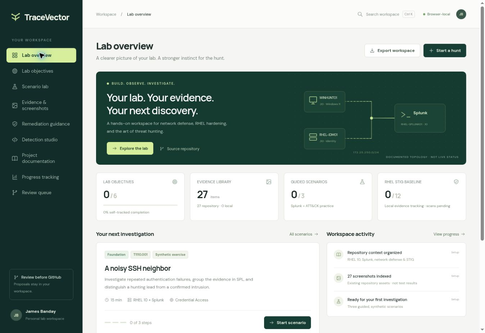
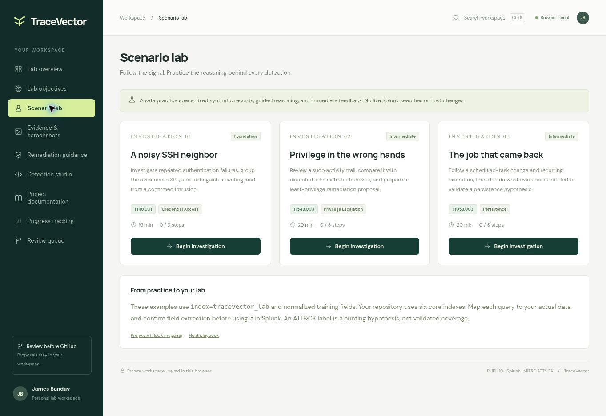
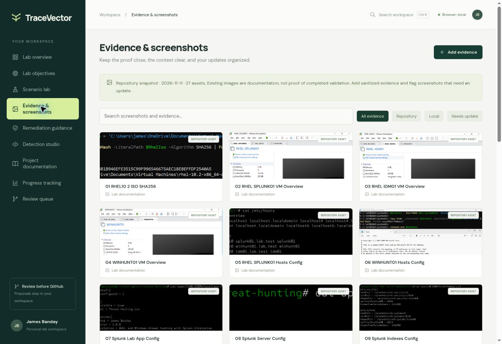
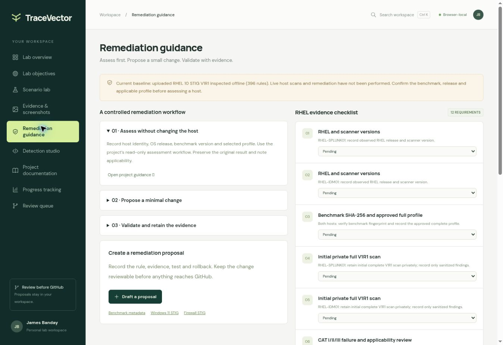
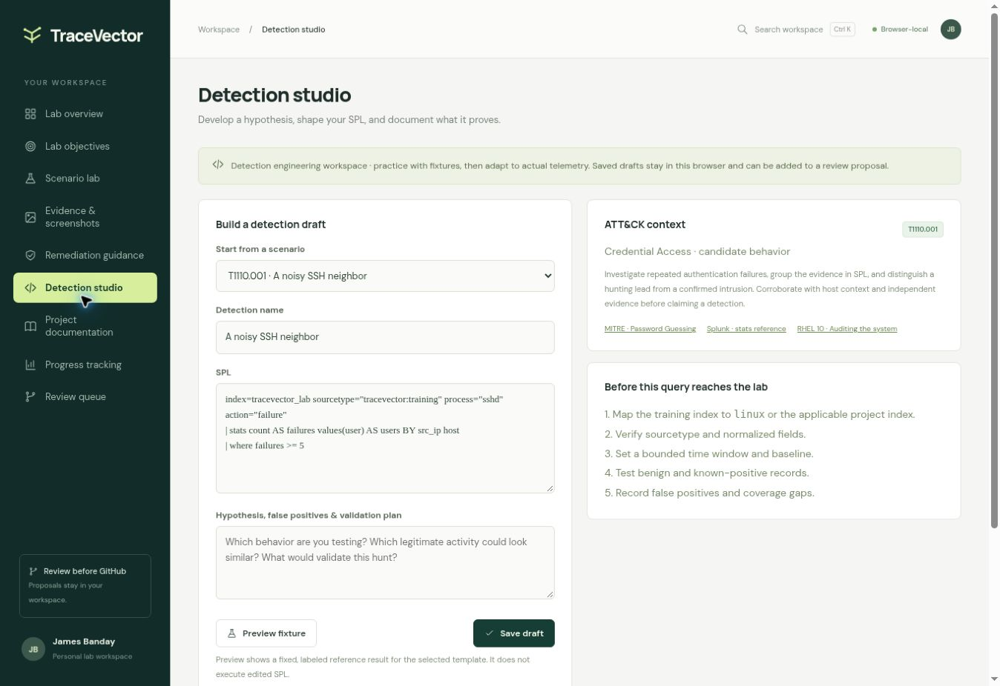
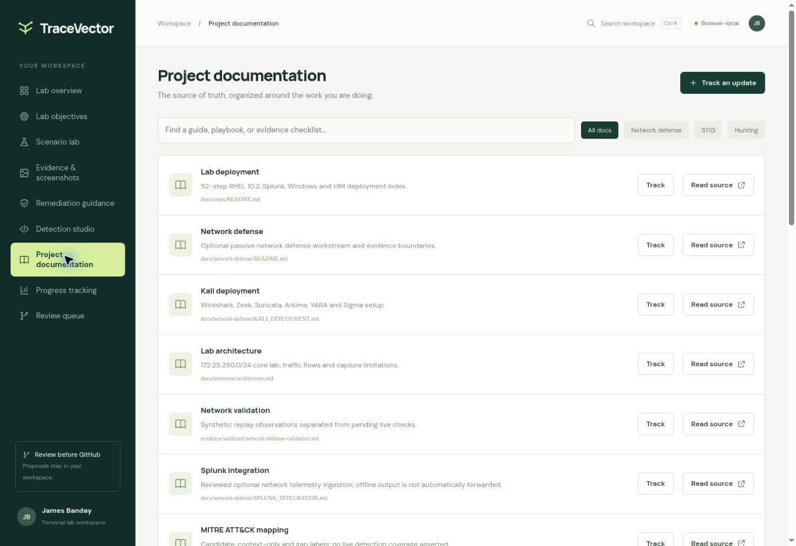
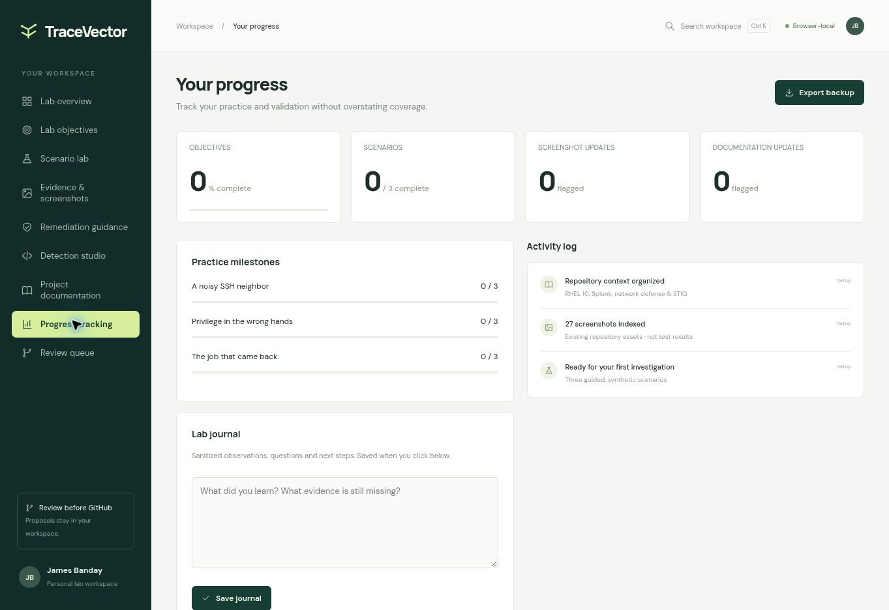
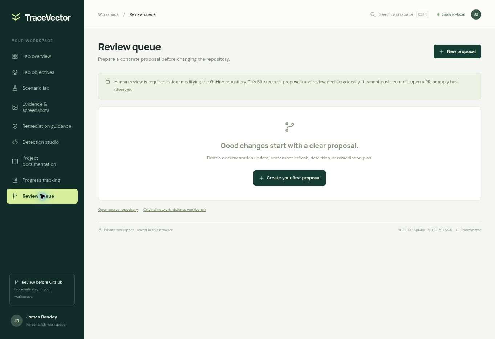
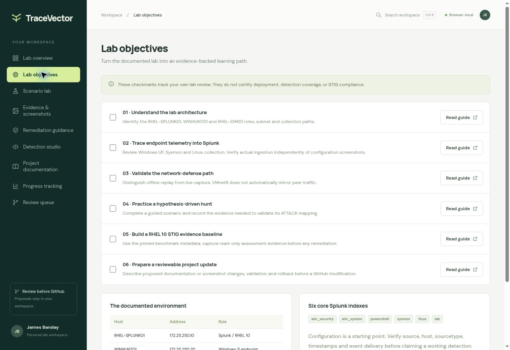

# TraceVector · Threat Hunting Lab

[Open the private TraceVector Site](https://tracevector-lab.jamesbanday.chatgpt.site) · [Start a guided hunt](https://tracevector-lab.jamesbanday.chatgpt.site/#scenarios) · [Browse current source](../../website/tracevector-lab/)

TraceVector brings guided Splunk hunts, MITRE ATT&CK context, evidence, documentation, STIG guidance, detection drafts, and progress into one personal workspace. This guide describes **Site version 1, published November 11, 2026**, with matching source and screenshots.

## Access and scope

The hosted Site is private to James Banday and requires his ChatGPT sign-in. Repository visitors can read the source and screenshots; these files do not grant access to the hosted workspace.

TraceVector saves progress, notes, attachments, drafts, and review decisions in the current browser. It does not run Splunk searches, connect to lab systems, apply remediation, or modify GitHub. Practice completion and tracked evidence remain separate from verified detections, live test results, and compliance findings.

## Explore the workspace

| Section | What it provides |
| --- | --- |
| [Lab overview](https://tracevector-lab.jamesbanday.chatgpt.site/#overview) | Documented lab topology, progress totals, the next investigation, and recent activity. |
| [Lab objectives](https://tracevector-lab.jamesbanday.chatgpt.site/#objectives) | Six learning objectives with source guides and personal completion checkboxes. |
| [Scenario lab](https://tracevector-lab.jamesbanday.chatgpt.site/#scenarios) | Three guided hunts with synthetic records, SPL examples, questions, and immediate feedback. |
| [Evidence & screenshots](https://tracevector-lab.jamesbanday.chatgpt.site/#evidence) | A catalogue of 27 existing repository images, local evidence attachments, notes, search, and update flags. |
| [Remediation guidance](https://tracevector-lab.jamesbanday.chatgpt.site/#remediation) | An assess, propose, and validate workflow, plus 12 RHEL STIG evidence requirements. |
| [Detection studio](https://tracevector-lab.jamesbanday.chatgpt.site/#detections) | Editable SPL drafts, ATT&CK context, validation notes, and fixed reference results. |
| [Project documentation](https://tracevector-lab.jamesbanday.chatgpt.site/#docs) | Eighteen linked project guides with search, filters, notes, and proposed update tracking. |
| [Progress tracking](https://tracevector-lab.jamesbanday.chatgpt.site/#progress) | Objective and scenario progress, an activity log, a lab journal, and backup export/import. |
| [Review queue](https://tracevector-lab.jamesbanday.chatgpt.site/#review) | Documentation, screenshot, detection, and remediation proposals with local review decisions and Markdown export. |

The documentation and image catalogues are a curated snapshot, not an automatic GitHub sync. The nine interface captures below are separate from the Site's 27 existing image references.

## Guided hunts

Each hunt has three steps: inspect the synthetic records, reason through the search or behavior, and identify the evidence needed for validation.

| Hunt | Focus | ATT&CK hypothesis | Estimated practice |
| --- | --- | --- | --- |
| A noisy SSH neighbor | Repeated SSH authentication failures | T1110.001 · Password Guessing | 15 minutes |
| Privilege in the wrong hands | Unexpected use of sudo privileges | T1548.003 · Sudo and Sudo Caching | 20 minutes |
| The job that came back | A recurring cron task | T1053.003 · Cron | 20 minutes |

The examples use `index=tracevector_lab` and normalized training fields. This is a synthetic placeholder, not a seventh configured lab index. Before using a draft in Splunk, map it to the appropriate existing index: `win_security`, `win_system`, `powershell`, `sysmon`, `linux`, or `lab`; confirm field extraction, choose a time window, and test expected and unexpected activity.

**Preview fixture** shows a fixed result for the original scenario template. It does not execute edited SPL. ATT&CK labels describe hunting hypotheses that require supporting evidence.

## Save and restore your work

1. Use **Export workspace** on the overview or **Export backup** in Progress tracking to download `tracevector-workspace.json`.
2. Keep this backup private: it includes notes, progress, detection drafts, proposals, and local evidence attachments.
3. In Progress tracking, choose **Import backup**, select a compatible file, and review the confirmation before replacing the current browser's workspace.

Work is stored separately for each browser and site address. Export a backup before clearing browser data or moving to another device. The older workbench's checklist export uses a different format and is not a TraceVector workspace backup.

## Review proposed changes

Create a proposal from documentation tracking, a saved detection, remediation guidance, or the Review queue. Record the intended repository path, proposed content, evidence, validation plan, and rollback.

The available decisions are **Awaiting review**, **Reviewed — ready for manual application**, **Changes requested**, and **Deferred**. Saving a decision records it locally. **Export proposal** downloads `tracevector-proposal.md`; applying its contents to GitHub remains a separate reviewed action.

## Lab and STIG context

The documented network remains `172.25.250.0/24`: RHEL-SPLUNK01 at `.10`, WINHUNT01 at `.20`, RHEL-IDM01 at `.30`, and the NAT gateway at `.2`. Optional Kali analysis uses a verified unique DHCP lease. VMnet8 does not automatically mirror peer traffic, and optional sensor deployment and live acceptance remain subject to their project evidence records.

The STIG section links the repository's RHEL 10 guidance and benchmark metadata. Its 12 evidence items start as **Pending** and can be tracked as **In progress** or **Captured locally**. These are evidence-tracking labels; a completed checklist does not establish compliance or prove a host was scanned.

## Screenshot gallery

These captures show the current source in a local preview with an empty personal workspace. They document the interface; they do not establish live lab operation, detection coverage, or STIG compliance.

### Figure 1 — Lab overview

Figure 1: The overview brings lab topology, learning objectives, evidence, guided hunts, and STIG tracking into one dashboard.

### Figure 2 — Scenario lab

Figure 2: The scenario lab provides three guided hunts using synthetic records, Splunk examples, and MITRE ATT&CK hypotheses.

View Figures 3–9: evidence, remediation, detection, documentation, progress, review, and objectives

### Figure 3 — Evidence tracking

Figure 3: The evidence view organizes repository screenshots and local records with search, notes, and update flags.

### Figure 4 — Remediation guidance

Figure 4: The remediation view links assessment guidance, proposed changes, and twelve RHEL STIG evidence requirements.

### Figure 5 — Detection studio

Figure 5: The detection studio supports SPL drafts, ATT&CK context, and validation notes with fixed training previews.

### Figure 6 — Project documentation

Figure 6: The documentation view groups project guides and tracks proposed updates for review.

### Figure 7 — Progress tracking

Figure 7: The progress view combines practice milestones, a lab journal, activity history, and backup export/import.

### Figure 8 — Review queue

Figure 8: The review queue stores proposed changes and review decisions before separate application to GitHub.

### Figure 9 — Lab objectives

Figure 9: The objectives view tracks six learning goals and links each goal to supporting project guidance.

## Source and validation record

The five application files in [`website/tracevector-lab/`](../../website/tracevector-lab/) match published Site version 1 at source commit `69ab9c0e7cfe50e00e92a087c643f0356419e805`. They contain the interface and reference content, not personal browser data or hosting credentials.

The original Site release handoff reported **84 interaction checks passed** and visual verification of the published dashboard. That is the reported release result; it is separate from the repository checks performed when synchronizing this source. Neither result establishes successful lab deployment or a completed security assessment.

Repository synchronization checks on November 11, 2026:

| Check | Observed result |
| --- | --- |
| Project source validation | Passed. |
| Repository unit tests | 85 discovered: 84 passed; one offline Suricata replay skipped because the engine was unavailable. |
| Publication preflight | Passed for 429 Git-visible paths. |
| Application source | All five files match the published source byte for byte; all three JavaScript files passed syntax checks. |
| Documentation links | All 110 local links in the five updated guides resolve. |
| Browser views | All nine sections opened and were visually inspected; nine screenshots were captured with empty personal workspace data. |

These checks did not rerun the original 84-interaction Site suite or test live Splunk searches, host remediation, or STIG compliance.

## Earlier network-defense workbench

The [original private workbench](https://banday-network-workbench.jamesbanday.chatgpt.site), [its source](../../website/network-defense-lab/), and [five reference captures](../../screenshots/network-defense-lab/) remain available for architecture, tool references, traffic paths, deployment phases, and the original ten-check validation workflow. Its checklist and browser storage are separate from the current TraceVector workspace.

## References

- [MITRE ATT&CK workstream](../mitre-attack/README.md): This guide connects hunting hypotheses, source coverage, and validation evidence.
- [Splunk data-health search](../../hunts/00-data-health.spl): This search helps inspect data availability before adapting a detection draft.
- [RHEL 10 STIG implementation guide](../stig-rhel10/IMPLEMENTATION_GUIDE.md): This guide explains assessment, controlled remediation, and evidence requirements.
- [Kali deployment guide](KALI_DEPLOYMENT.md): This guide covers analysis tools, offline replay, optional capture, and acceptance checks.
- [Lab architecture](../reference/architecture.md): This reference documents system roles, network addresses, and traffic visibility limits.
- [Evidence sanitization](../reference/security-and-sanitization.md): This checklist explains how to review evidence before publishing it.
