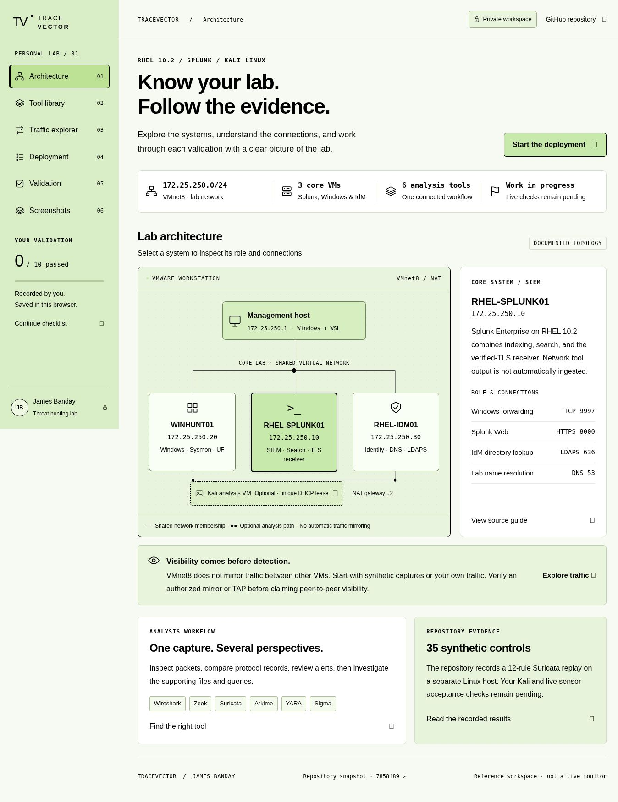
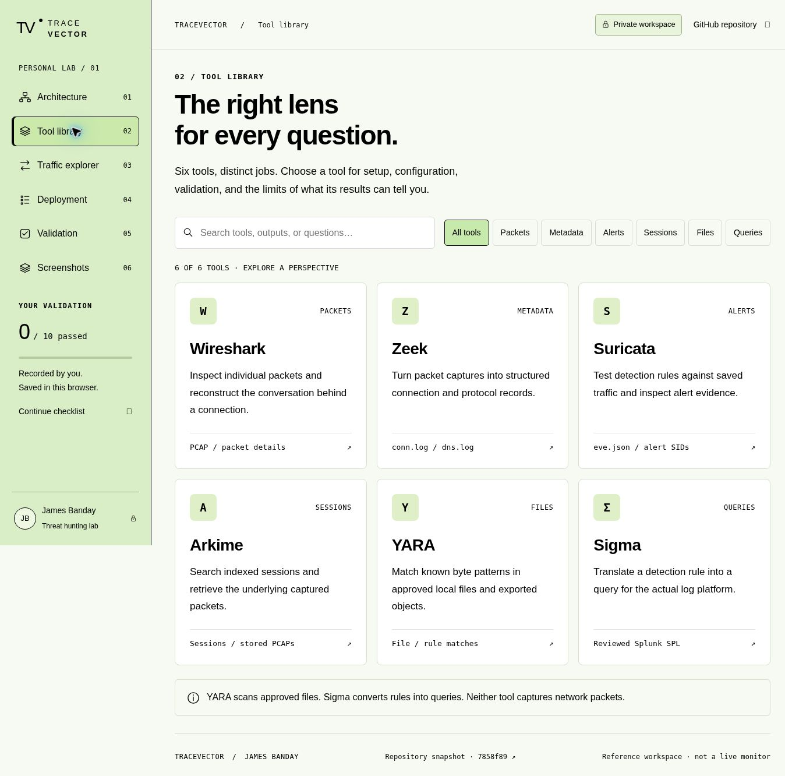
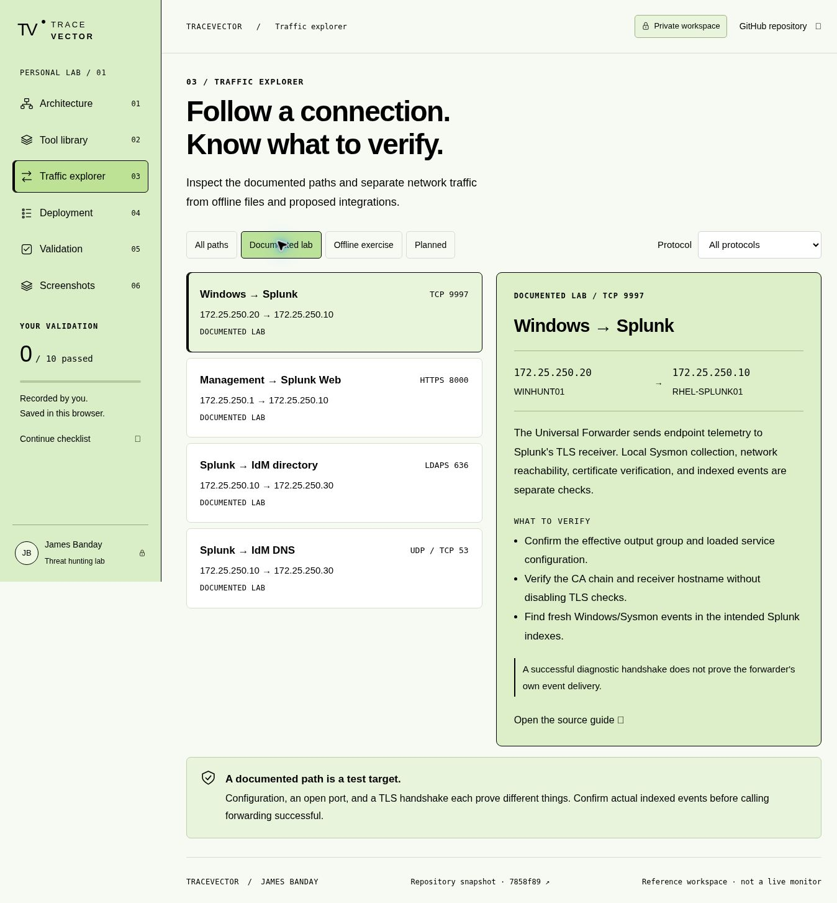
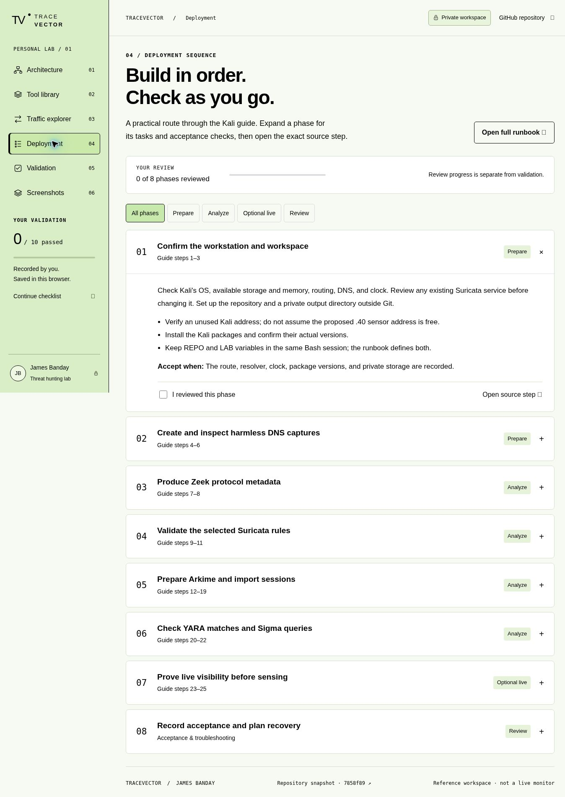
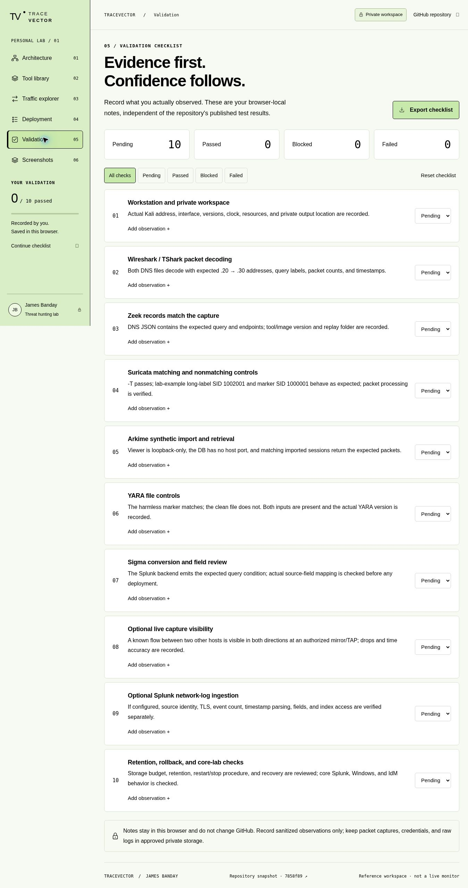

# TraceVector | James Banday

[Open the private website](https://banday-network-workbench.jamesbanday.chatgpt.site) · [Browse website source](../../website/network-defense-lab/) · [Kali deployment runbook](KALI_DEPLOYMENT.md)

TraceVector provides an interactive reference for the RHEL 10.2 Splunk lab. It uses light green surfaces and black typography, with 18px body text on desktop and larger navigation, labels, and architecture cards. Its content is based on repository commit `7858f891d9d2ea254d0758383951ba352cec7dc1`; the website's footer links to that snapshot.

## Access and scope

The hosted website is private to James Banday's account and requires ChatGPT sign-in. Publishing this documentation, source, and screenshot gallery does not grant access to the hosted website.

The website does not connect to the lab VMs, collect packets, execute its example commands, or change GitHub. Checklist statuses and sanitized notes remain in the current browser; JSON export creates a local copy. Review progress is separate from evidence of successful validation. The screenshots contain no private notes, and all ten acceptance checks remain **Pending**.

## Explore the lab

| View | Use it to |
| --- | --- |
| Architecture | Select systems and inspect roles, addresses, connections, and source documentation. |
| Tool library | Search and filter Wireshark, Zeek, Suricata, Arkime, YARA, and Sigma; inspect installation, configuration, validation, and command references. |
| Traffic explorer | Filter documented, offline, and proposed paths by traffic type and protocol; inspect source/destination and acceptance checks. |
| Deployment | Expand eight phases covering the Kali runbook and separately track which phases you reviewed. |
| Validation | Track ten checks as Pending, Passed, Blocked, or Failed; add sanitized observations and export the checklist. |
| Screenshots | Browse refreshed captures of the five working views and open each image at full size. |

The architecture preserves Splunk `.10`, Windows `.20`, IdM `.30`, management `.1`, and NAT gateway `.2` on `172.25.250.0/24`. Kali must use a unique, verified DHCP lease rather than an assumed fixed address. VMnet8 does not automatically mirror peer traffic. The eight-rule lab example and separate 12-rule Suricata regression pack reuse SIDs for different detections and must be tested separately.

## Screenshot gallery

These refreshed TraceVector browser screenshots show the local preview of the source used for the privately deployed website. They are interface documentation, not evidence that a Kali workstation, sensor, forwarding path, or detection is operating.

### Figure 1 — Architecture

Figure 1: The architecture view shows the three core VMs, management host, NAT gateway, and optional Kali analysis path.

### Figure 2 — Tool library

Figure 2: The tool library organizes six analysis tools by their roles, outputs, setup procedures, and validation checks.

### Figure 3 — Traffic explorer

Figure 3: The traffic explorer filters documented connections and explains what to verify for Windows-to-Splunk TLS forwarding.

### Figure 4 — Deployment

Figure 4: The deployment view presents eight phases with tasks, acceptance checks, source links, and separate review checkboxes.

### Figure 5 — Validation

Figure 5: The validation view starts with ten pending checks and supports browser-local notes, status filters, and JSON export.

## References

- [Kali deployment guide](KALI_DEPLOYMENT.md): Provides the installation, configuration, replay, optional capture, acceptance, and rollback procedures summarized by the website.
- [Lab architecture](../reference/architecture.md): Documents VM roles, network addresses, core data flows, and capture limitations.
- [Network validation record](../../evidence/sanitized/network-defense-validation.md): Separates recorded synthetic replay results from pending checks in the actual lab.
