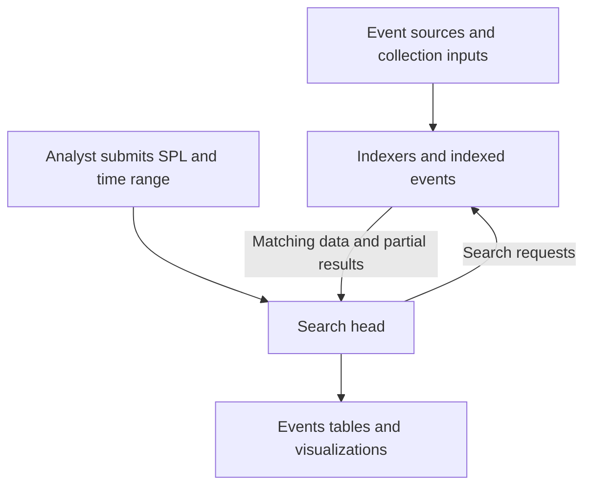

# Splunk Threat Hunting Reference Guide

[Reference index](README.md) · [Hunting method](../security-operations/THREAT_HUNTING_METHOD.md) · [Incident workflow](../security-operations/INCIDENT_MANAGEMENT.md)

Use this reference to scope an investigation in the owned, isolated RHEL 10.2 Splunk lab, explain SPL pipelines, validate results, and troubleshoot missing evidence. The [account-alert triage guide](../security-operations/GOOGLE_ACCOUNT_ALERT_TRIAGE.md) applies the same evidence distinctions to a synthetic Google account scenario.

> **Evidence and scope:** This reference adapts reviewed study findings to the repository's lab. Official references identify the documentation versions used. Installed Splunk and add-on builds, field mappings, collection, query execution, and detection outcomes remain unverified. Thresholds are illustrative. No configurations or live systems are changed by this guide. Documentation reviewed November 11, 2026.

## Analyst quick reference

1. **Scope:** write a hypothesis, affected identity or host, exact start and end times, and timezone.

2. **Check coverage:** confirm the expected index, source type, permissions, retention, and recent ingestion before interpreting a zero count.

3. **Inspect events:** verify the relevant fields against a few complete raw records.

4. **Build incrementally:** filter, extract or normalize, aggregate, then present. Check the output after each added command.

5. **Validate:** wait for completion, review job warnings, and pivot suspicious aggregates back to raw events.

6. **Record:** preserve the SPL, time bounds, search ID, evidence, alternative explanations, and next action.

| Need | Pattern or check |
| --- | --- |
| Start with a bounded dataset | `index=win_security earliest=-1h latest=now` |
| Require a field to be populated | `field=*` in the base search |
| Count event rows | `stats count AS events` |
| Count distinct identities | `stats dc(user) AS users` |
| Summarize by source address | `stats count AS events BY src_ip` |
| Preserve chronological order | `sort 0 +_time` after narrowing the dataset |
| Show investigation fields | Put `table` at the end of the pipeline |
| Explain no matches | Test coverage and remove restrictive clauses one at a time |

Select the appropriate existing lab index for each dataset; the examples below state their field assumptions. `dc()` counts distinct values, while `count(field)` counts populated occurrences of that field. A result row after aggregation can represent many events. See [statistical functions](https://help.splunk.com/en/splunk-enterprise/search/spl-search-reference/10.6/statistical-and-charting-functions/statistical-and-charting-functions).

## Splunk search process

### How data and searches move

In a distributed deployment, inputs such as forwarders send data to indexers. A search head distributes searches to indexers, which search their indexed data; the search head consolidates results for the analyst. A standalone installation can combine roles. This separation helps distinguish a collection failure from a search problem. See [indexers in a distributed deployment](https://help.splunk.com/en/splunk-enterprise/administer/manage-indexers-and-indexer-clusters/10.4/indexing-overview/indexers-in-a-distributed-deployment).



Read the SPL pipeline from left to right: each command consumes the preceding output. Physical execution can be optimized; the Job Details dashboard exposes the optimized search and applicable map and reduce search strings. See [search job properties](https://help.splunk.com/en/splunk-enterprise/search/search-manual/9.1/manage-jobs/view-search-job-properties).

### Run an investigation step by step

1. **Define the question.** For example, “Did one source attempt logons to many accounts in a 15-minute period?” Specify what evidence would strengthen or weaken the hypothesis.

2. **Select data and time.** Choose the relevant index and source type. Start with a manageable interval around a known event and expand deliberately.

3. **Confirm collection.** Count events by source type, then inspect raw samples. Verify that the username is the target account and that the address is the source of the logon, rather than a collector address.

4. **Add logic gradually.** Add the event type, field requirements, grouping, and thresholds in separate iterations. Keep a working base search for later pivots.

5. **Review the completed job.** Check warnings and peer failures. A running preview is provisional.

6. **Investigate candidates.** Compare with normal behavior, maintenance, asset ownership, and related authentication or endpoint evidence.

7. **Save a reproducible record.** Replace moving relative windows with fixed bounds when documenting a finding. Include the timezone and any coverage gaps.

For a first Windows Security coverage check:

```spl
index=win_security earliest=-1h latest=now
| stats count AS events BY sourcetype
```

For raw inspection, run the base search without aggregation and expand individual events. A small `head 20` sample helps inspect structure, but does not establish completeness or representativeness.

### Choose the search mode

| Mode | Useful behavior |
| --- | --- |
| Smart | Default; discovers fields for event searches and favors reporting results for transforming searches. |
| Verbose | Discovers available fields and retains event views alongside reporting output; useful while validating a hunt. |
| Fast | Limits field discovery, while still returning search-time fields explicitly referenced in the search. |

Use Smart for routine work and Verbose when checking extractions or the events behind a report. Mode affects the available event and field views; a missing sidebar field is not sufficient evidence that the original event lacks it. See [search modes](https://help.splunk.com/en/splunk-enterprise/search/search-manual/10.6/use-the-search-app/search-modes).

### Set time bounds correctly

`_time` is Splunk's event timestamp; `_indextime` records when the event was indexed. `earliest` is inclusive and `latest` is exclusive. Explicit SPL time modifiers override the corresponding time-picker range. `earliest=-24h` is a rolling day; `earliest=-1d@d latest=@d` selects the previous calendar day using the search's timezone context. Preserve epoch timestamps when timezone ambiguity matters. See [time modifiers](https://help.splunk.com/en/splunk-enterprise/search/spl-search-reference/10.6/time-format-variables-and-modifiers/time-modifiers).

## Search commands and SPL syntax

### Commands used during investigations

| Command | Purpose | Investigation use |
| --- | --- | --- |
| `search` | Filter events or current results | Select indexes, event codes, hosts, and indicators. |
| `where` | Filter with expressions | Compare fields or apply calculated thresholds. |
| `eval` | Calculate fields | Normalize names or convert byte units. |
| `fields` | Retain or remove fields | Keep the fields needed downstream. |
| `table` | Present selected columns | Create the final evidence view. |
| `bin` | Group a numeric field into intervals | Create fixed time buckets. |
| `timechart` | Aggregate on a time axis | Inspect changes in event volume. |
| `dedup` | Remove repeated field combinations | List distinct candidates; preserve counts separately. |
| `lookup` | Enrich using configured reference data | Add approved asset or identity context. |
| `spath` | Extract JSON or XML fields | Inspect structured payloads. |
| `rex` | Extract named regex groups | Parse a field from unstructured text. |

See the [SPL command reference](https://help.splunk.com/en/splunk-enterprise/search/spl-search-reference/10.6/quick-reference/command-quick-reference) for command-specific syntax. `rex` defaults to `_raw` when no field is supplied; validate the extraction against the actual log format. See [rex](https://help.splunk.com/en/splunk-enterprise/search/spl-search-reference/10.0/search-commands/rex).

`stats` produces aggregate rows and retains only its grouping fields and calculated outputs. `eventstats` adds group statistics to the existing events. `streamstats` adds running statistics in the order events arrive; chronological reasoning requires deliberate ordering and attention to its window and resource limits. See [stats and related commands](https://help.splunk.com/en/splunk-enterprise/search/search-manual/10.0/calculate-statistics/use-the-stats-command-and-functions) and [streamstats](https://help.splunk.com/en/splunk-enterprise/spl-search-reference/10.2/search-commands/streamstats).

Useful aggregates include `count`, `dc(field)`, `values(field)`, `sum(field)`, `min(_time)`, and `max(_time)`. `values()` is a set of distinct values, not an ordered event history. Keep raw events when sequence matters. See [statistical functions](https://help.splunk.com/en/splunk-enterprise/search/spl-search-reference/10.6/statistical-and-charting-functions/statistical-and-charting-functions).

### Syntax traps that change the answer

- The initial `search` command is implied. Spaces between terms imply `AND`. Use uppercase Boolean operators and explicit parentheses around mixed conditions.

- `search` evaluates `OR` before `AND`; `where` and `eval` evaluate `AND` before `OR`. Parenthesize the intended logic rather than relying on precedence.

- Use `where fieldA=fieldB` to compare two fields. In a `search` comparison, `fieldB` is interpreted as a literal value.

- After `stats`, filters can use only fields that survived the aggregation. A later search for raw text cannot recover discarded `_raw` data.

See [search command behavior](https://help.splunk.com/en/splunk-enterprise/spl-search-reference/10.0/search-commands/search).

`status!=200` requires a present status value other than 200; `NOT status=200` can also match events without that field. Decide whether missing values belong in the hunt. See [the difference between != and NOT](https://help.splunk.com/en/splunk-enterprise/search/search-manual/10.6/expressions-and-predicates/difference-between-and-not).

`sort` returns at most 10,000 rows by default. `sort 0` removes that command's row limit and can be expensive; it does not remove other search limits. Narrow the dataset first. See [sort](https://help.splunk.com/en/splunk-enterprise/spl-search-reference/9.0/search-commands/sort).

## Practical SPL threat hunting examples

### Validate the example schema first

These are investigation templates, not deployed detections. The repository's six indexes remain `win_security`, `win_system`, `powershell`, `sysmon`, `linux`, and `lab`. Authentication examples use `win_security`, and process examples use `sysmon`. Confirm actual source types and extracted fields in collected lab events. The outbound-volume example is an optional synthetic proxy exercise in `lab`; `lab:proxy:http` and its fields are assumed sample schema, not a configured feed.

| Dataset | Assumed fields and meaning |
| --- | --- |
| Windows Security | `EventCode`, `TargetUserName`, `TargetDomainName`, `IpAddress`, `LogonType`, and `host`. Use the target account, not the Subject account. |
| Sysmon process creation | `EventCode`, `Image`, `CommandLine`, `ParentImage`, `User`, `ProcessGuid`, and `host`. |
| Proxy | `src_ip`, `dest_domain`, and numeric `bytes_out` representing bytes sent from the client toward the destination. |

Windows event 4625 records a failed logon; event 4624 records a successful logon session. Their collection and populated fields depend on audit configuration and authentication context. See Microsoft's [4625 reference](https://learn.microsoft.com/en-us/previous-versions/windows/it-pro/windows-10/security/threat-protection/auditing/event-4625) and [4624 reference](https://learn.microsoft.com/en-us/previous-versions/windows/it-pro/windows-10/security/threat-protection/auditing/event-4624). The field names exposed by a Splunk add-on can differ from the event XML names.

### Hunt 1 Many failed logons from one source

**Hypothesis:** one source may be attempting passwords across multiple accounts. The thresholds below are starting assumptions for triage and need a local baseline.

```spl
index=win_security sourcetype="XmlWinEventLog:Security" earliest=-24h latest=now EventCode=4625 TargetUserName=* TargetUserName!="-"
| eval src_ip=IpAddress, account=lower(coalesce(TargetDomainName,"UNKNOWN").":".TargetUserName)
| where isnotnull(account) AND isnotnull(src_ip) AND src_ip!="-"
| bin _time span=15m
| stats count AS failures dc(account) AS accounts values(host) AS targets BY _time src_ip
| where failures>=10 AND accounts>=5
| sort 0 -failures
```

1. Select failed logons and map the source address and target identity. The domain prefix helps distinguish identically named accounts; `UNKNOWN` explicitly marks a missing domain.

2. Bucket event time into fixed 15-minute intervals.

3. Count failed events and distinct accounts for each source and interval.

4. Review candidates meeting both assumed thresholds, then examine failures, successes, failure reasons, and affected hosts in raw records.

**Interpretation example, synthetic:** 24 failures against six accounts from one address in one bucket satisfies this query. It supports investigating a spray pattern; it does not establish malicious intent or successful access. NAT gateways, testing tools, stale credentials, and service misconfiguration can produce similar patterns. Fixed buckets can split a burst at a boundary; slower or distributed attempts can evade these thresholds.

### Hunt 2 Failed and successful logons for the same identity

**Hypothesis:** repeated failures and a success close together deserve review. This query finds co-occurrence within a bucket; it does not establish that failures preceded the success.

```spl
index=win_security sourcetype="XmlWinEventLog:Security" earliest=-24h latest=now (EventCode=4624 OR EventCode=4625) TargetUserName=* TargetUserName!="-"
| eval src_ip=IpAddress, account=lower(coalesce(TargetDomainName,"UNKNOWN").":".TargetUserName)
| where isnotnull(account) AND isnotnull(src_ip) AND src_ip!="-"
| bin _time span=10m
| stats count(eval(EventCode=4625)) AS failures count(eval(EventCode=4624)) AS successes values(LogonType) AS logon_types BY _time account src_ip host
| where failures>=5 AND successes>=1
| sort 0 -failures
```

1. Collect both event types using the same time range and identity mapping.

2. Count failures and successes per account, source, destination host, and fixed interval.

3. Pivot each candidate to the original events, sort ascending by `_time`, and inspect precise timestamps and event identifiers to determine order. Equal timestamps may not establish a unique sequence.

4. Validate the logon type and whether the destination, source, and user activity are expected. Check related endpoint activity before concluding that a password was guessed.

Conditional counts inside `stats` are documented in the [stats reference](https://help.splunk.com/en/splunk-enterprise/search/spl-search-reference/10.6/search-commands/stats). These results depend on both success and failure auditing being collected. Missing source addresses, inconsistent domain formats, and events crossing bucket boundaries require separate follow-up.

### Hunt 3 PowerShell command lines needing review

**Hypothesis:** process creation logs may reveal encoded commands or download-related strings. Sysmon event ID 1 records process creation and command-line context. See [Microsoft Sysmon](https://learn.microsoft.com/en-us/sysinternals/downloads/sysmon).

```spl
index=sysmon sourcetype="XmlWinEventLog:Microsoft-Windows-Sysmon/Operational" earliest=-24h latest=now EventCode=1 (Image="*powershell.exe" OR Image="*pwsh.exe")
| where match(CommandLine,"(?i)(-enc(odedcommand)?[[:space:]]|frombase64string|downloadstring)")
| sort 0 +_time
| table _time host User Image ParentImage CommandLine ProcessGuid
```

1. Confirm Sysmon process events and command lines are present for the relevant hosts.

2. Filter the named PowerShell executables for a small set of review indicators.

3. Inspect the parent process, full command, user, executable location, and surrounding events. Decode captured text as data for inspection; do not run it.

4. Correlate the process identifier with related telemetry, if collected, and compare the activity with approved administration.

This string-based hunt is deliberately incomplete: it can miss alternative argument abbreviations, renamed binaries, and obfuscation. Encoded commands and these strings also occur in legitimate tooling. The regular expression and field mapping must be validated against representative local events. See [evaluation functions](https://help.splunk.com/en/splunk-enterprise/search/spl-search-reference/10.6/evaluation-functions/evaluation-functions) for `match()`.

### Hunt 4 High outbound volume by client and destination

**Hypothesis:** an unusually large transfer may warrant an exfiltration review. First verify that `bytes_out` means client-to-destination bytes in this source; some products use different directions or include response traffic.

```spl
index=lab sourcetype="lab:proxy:http" earliest=-24h latest=now src_ip=* dest_domain=*
| eval sent=tonumber(bytes_out)
| where isnotnull(sent) AND sent>=0
| bin _time span=1h
| stats sum(sent) AS bytes_sent count AS requests BY _time src_ip dest_domain
| eval MiB=round(bytes_sent/1048576,2)
| where MiB>=100
| sort 0 -bytes_sent
```

1. Require the client and destination fields, convert bytes to a number, and exclude invalid measurements.

2. Sum bytes within fixed hourly groups, then convert to MiB using 1,048,576 bytes per MiB.

3. Treat 100 MiB as an illustrative review threshold. Compare with that host's prior behavior, business role, and destination history.

4. Inspect request methods, URLs, user identity, approved backups, synchronization, and endpoint activity before classifying the transfer.

The query omits events missing grouping fields or usable byte counts. Encrypted traffic visibility and proxy logging coverage determine what it can establish. A large transfer alone is not proof of data theft.

## Interpreting search results

### Move from an aggregate to evidence

1. **Read the unit.** `failures` counts log events, `accounts` counts normalized distinct identities, and `MiB` sums the assumed outbound byte field. None necessarily counts unique human actions.

2. **Check the grouping.** A `stats` row represents a combination of its `BY` fields. Missing grouping values can exclude events; inspect missing-field records separately before trusting totals.

3. **Check the interval.** A bucket timestamp marks an interval, rather than necessarily the time of its first event. A partial current bucket can distort comparisons with completed buckets.

4. **Reopen the evidence.** Rerun the base query with the candidate's actual fields and exact interval. Inspect raw records and identifiers instead of inferring a sequence from `values()` or aggregate counts.

5. **Test alternative explanations.** Consider authentication failures caused by expired credentials, centralized egress, maintenance, and approved automation.

6. **State the supported conclusion.** Distinguish “events match this pattern” from “credentials were compromised” or “data was exfiltrated.” Record the evidence needed for the stronger conclusion.

For the first spray candidate, replace the source address and use the bucket's fixed bounds before investigating. This example uses the lab Windows address and is not an indicator of compromise:

```spl
index=win_security sourcetype="XmlWinEventLog:Security" earliest=-24h latest=now IpAddress="172.25.250.20" (EventCode=4624 OR EventCode=4625)
| sort 0 +_time
| table _time host EventCode TargetDomainName TargetUserName IpAddress LogonType Status SubStatus _raw
```

The rolling time range above is a starting template. Replace it with the candidate's actual interval; do not treat it as an exact replay of a historical search.

### Preserve a reviewable investigation record

- Hypothesis, scope, dataset, timezone, and exact bounds.

- SPL and search ID, completion status, warnings, and collection limitations.

- Observed counts plus representative raw events and stable event identifiers.

- Identity and asset context, alternative explanations, and confidence.

- Finding, outstanding checks, owner, and next action under the incident process.

Treat duplicate collection, missing fields, truncated command lines, and unknown device ownership as evidence limitations. Zero matches means no matches in the searched, accessible dataset under those conditions; it does not establish that the activity never occurred.

## Troubleshooting common search issues

### Diagnose the symptom

| Symptom | Checks and next action |
| --- | --- |
| No results | Check time, index spelling, source type, role access, retention, and ingestion. Remove filters incrementally and look for a known event. |
| Empty columns | Inspect `_raw`, extraction settings, app context, and search mode. Check whether `stats`, `fields`, or `table` removed the required fields. |
| Missing groups | Inspect events without each `BY` field. Separate unknown values explicitly when appropriate and document the effect on totals. |
| Unexpected matches | Add parentheses, verify field-versus-literal comparisons, and distinguish missing values from explicit nonmatches. |
| Different totals | Align time bounds, filters, mode, completed job state, grouping, duplicate handling, and field normalization. |
| Slow search | Narrow index, source type, time, and candidate fields. Delay broad sorting and inspect command costs before changing limits. |
| Partial or truncated output | Review job messages, peer errors, sampling, explicit limits, and subsearch behavior. Do not classify a partial result as complete coverage. |
| Old or shifted timestamps | Compare the source timestamp with `_time`, timezone settings, and `_indextime`. Check parsing and collection delays. |

For job diagnosis, run the search, select **Job → Inspect Job**, and review warnings, the search ID, `search.log`, and the Job Details dashboard. Some diagnostic panels need additional permissions. See [search job properties](https://help.splunk.com/en/splunk-enterprise/search/search-manual/9.1/manage-jobs/view-search-job-properties).

Subsearch row and runtime limits depend on the command, version, and configuration. Inspect the applicable limits and job warnings instead of assuming one universal limit. See the [limits.conf reference](https://help.splunk.com/en/data-management/splunk-enterprise-admin-manual/10.4/configuration-file-reference/10.4.0-configuration-file-reference/limits.conf).

### Separate ingestion delay from timestamp problems

```spl
index=win_security earliest=-24h latest=now
| eval ingest_delay_seconds=_indextime-_time
| stats count AS events median(ingest_delay_seconds) AS median_delay_seconds max(ingest_delay_seconds) AS max_delay_seconds BY sourcetype
```

The difference can reflect transport delay, backfill, clock skew, or timestamp parsing; it is not automatically network latency. This query covers only events whose `_time` falls inside its window. When using `_index_earliest` or `_index_latest`, provide an event-time window broad enough to include the events too. See [index-time search modifiers](https://help.splunk.com/en/splunk-enterprise/search/spl-search-reference/10.6/time-format-variables-and-modifiers/time-modifiers).

For a missing source, trace the chain: event generation → input permissions and configuration → forwarder or HEC → destination index → retention and analyst access. Preserve evidence before changing collection settings.

## Mitigations and prevention

A hunt produces candidates. Confirm the behavior with raw evidence and asset or identity context, choose a response proportional to the impact, and verify the action in the system that enforces it.

### Immediate mitigations

| Finding | Response once the threat is supported |
| --- | --- |
| Active password spray | Identify affected accounts and validated attack sources. Apply targeted identity or network restrictions and monitor for changing sources; shared VPN or NAT addresses need careful handling. |
| Evidence of account access after attempted guessing | Restrict the affected account when warranted, reset exposed credentials, revoke applicable sessions or tokens, and investigate follow-on access and mailbox persistence. |
| Confirmed malicious PowerShell execution | Preserve command lines, process identifiers, and relevant logs. Use the endpoint response platform to contain the host, collect an investigation package, and stop or quarantine malicious artifacts. |
| Confirmed unauthorized outbound transfer | Contain the affected endpoint or connection, restrict validated malicious destinations, determine which data and credentials were exposed, and involve the incident and data owners. |

Identity response options and the risks of broad IP blocking are covered in [Microsoft's password spray playbook](https://learn.microsoft.com/en-us/security/zero-trust/security-operations-playbook-password-spray). Endpoint isolation can limit lateral movement and exfiltration; supported actions depend on the platform, device, and subscription. See [endpoint response actions](https://learn.microsoft.com/en-us/defender-endpoint/respond-machine-alerts). Network prevention options are described under [MITRE ATT&CK exfiltration mitigations](https://attack.mitre.org/techniques/T1041/).

### Preventive controls

- **Identity:** strengthen MFA, enforce strong unique credentials, and review legacy authentication exposure. Configure the identity provider's password protection and lockout controls for the actual authentication architecture. Microsoft Entra smart lockout is a specific capability, not a setting that automatically applies to every Windows logon. See [smart lockout](https://learn.microsoft.com/en-us/entra/identity/authentication/howto-password-smart-lockout).

- **Endpoint:** reduce unnecessary administrator access and use tested application and script controls. Application control can restrict executable code and PowerShell capabilities; validate legitimate administration before enforcement. See [application control and attack surface reduction](https://learn.microsoft.com/en-us/intune/device-configuration/endpoint-security/attack-surface-reduction).

- **Network and data:** limit unnecessary outbound access, monitor destination changes, and use appropriate network inspection and data loss prevention controls for sensitive data. See [exfiltration defenses](https://attack.mitre.org/techniques/T1041/).

- **Detection quality:** retain the logs required for investigations, monitor ingestion health, normalize identities and time, and baseline thresholds by asset role. Review both short bursts and longer patterns; a fixed threshold alone can miss slow or distributed attempts.

### Validate mitigation and recovery

1. Record the action, target, time, operator, and observed result.

2. Confirm the intended restriction or credential change took effect in the enforcing system.

3. Rerun the relevant hunt over new data and check collection health so that silence is not mistaken for successful containment.

4. Investigate remaining persistence and exposed data. Restore access or connectivity only after the response owner confirms the recovery conditions, then retain a focused follow-up watch in the incident process.

## Verified Splunk administration findings

These findings connect administration, ingestion, licensing, and authentication to search reliability. They summarize official documentation; they do not establish the current lab configuration or live collection status.

### Licensing and data coverage

Under ingest-volume licensing, ordinarily ingested Windows event data counts toward the quota. Splunk's own troubleshooting logs in `_internal` or `_introspection` are exempt. Index replication is not additional ingest volume. See [how licensing works](https://help.splunk.com/en/data-management/splunk-enterprise-admin-manual/10.6/configure-splunk-licenses/how-splunk-enterprise-licensing-works) and [distributed licensing](https://help.splunk.com/en/splunk-enterprise/administer/admin-manual/10.0/configure-splunk-licenses/licenses-and-distributed-deployments).

Summary indexing has licensing conditions: ingest-priced summaries using their designated summary source types are exempt; changing those source types can incur charges. Workload-priced summaries consume compute entitlement. Do not apply a daily-ingest exam rule to every subscription model. See [summary indexing and licensing](https://help.splunk.com/en/splunk-enterprise/manage-knowledge-objects/knowledge-management-manual/10.6/use-data-summaries-to-accelerate-searches/use-summary-indexing-for-increased-search-efficiency).

### Index retention and permissions

Separate indexes support different retention periods and role-based access boundaries. A hunt can miss data because the role lacks index access or because data is no longer searchable under the retention policy. See [index management](https://help.splunk.com/en/data-management/splunk-cloud-platform-admin-manual/10.2.2510/manage-your-indexes-and-data-in-splunk-cloud-platform/manage-splunk-cloud-platform-indexes).

### HTTP Event Collector

`/services/collector` accepts HEC JSON event data; customer-managed Enterprise defaults to HTTPS on port 8088, with configurable protocol and port. `/services/collector/raw` serves raw-event ingestion. These are ingestion endpoints, not the analyst's SPL search interface. Verify the actual deployment URL, token configuration, routing, and destination index when diagnosing missing events. See [HEC input endpoints](https://help.splunk.com/en/splunk-enterprise/leverage-rest-apis/rest-api-reference/9.1/input-endpoints/input-endpoint-descriptions).

### Forwarder connections

On a forwarder, inspect forwarding destinations with the installed Splunk CLI:

```text
splunk list forward-server
```

**Command overview:** `list forward-server` displays configured forwarding destinations and their connection status. **Summary:** run the installed CLI on the intended forwarder and inspect the actual output. An active connection does not prove that the required source was collected, indexed into the expected index, or made searchable. See [forwarder verification](https://help.splunk.com/en/splunk-enterprise/administer/admin-manual/10.6/get-the-most-out-of-splunk-enterprise-on-linux/integrate-a-universal-forwarder-onto-a-linux-system-image).

### Deployment server

A deployment server distributes apps and configuration updates to groups of deployment clients, including forwarders and supported non-clustered components. Management components need access to an Enterprise license. Client restarts depend on configuration, including `restartSplunkd` and `issueReload`; they are not unconditional. See [deployment server scope](https://help.splunk.com/en/splunk-enterprise/administer/update-your-deployment/9.0/deployment-server-and-forwarder-management/about-deployment-server-and-forwarder-management), [license requirements](https://help.splunk.com/en/splunk-enterprise/administer/admin-manual/10.0/configure-splunk-licenses/licenses-and-distributed-deployments), and [restart behavior](https://help.splunk.com/en/splunk-enterprise/administer/update-your-deployment/9.4/advanced-configuration/use-serverclass.conf-to-define-server-classes).

For missing logs after a configuration rollout, check client targeting, app delivery, and activation. Indexer cluster peers and search head cluster members use their respective cluster distribution mechanisms; do not assume that deployment server updates them directly.

### Duo authentication

Primary authentication, MFA verification, and session establishment are separate stages. Successful primary credentials do not by themselves prove completion of MFA or authorization to search an index.

For built-in Duo authentication, successful primary credentials lead to Duo and then back to Splunk to finish login. SAML SSO has an identity-provider flow whose screens and policy can differ. Check the configured integration and policy for the actual flow. See [built-in Duo for Splunk Enterprise](https://duo.com/docs/splunk) and [Duo SSO for Splunk Enterprise](https://duo.com/docs/sso-splunk-enterprise).

## Safe validation plan

Use synthetic records or the existing [harmless Windows activity procedure](../steps/28-generate-harmless-hunting-activity.md) in the owned lab. Do not generate password sprays against real accounts. Keep source events and account identifiers private.

| Hunt | Matching control | Nonmatching or interpretive control |
| --- | --- | --- |
| Many failed logons | Synthetic group of 10 failures against five identities from one source in one 15-minute bucket | Ten failures against four identities, or nine against five, must remain below one of the two thresholds. |
| Failures and success | Five failures and one success for the same grouping fields within one bucket | A success before the failures still matches: the query finds co-occurrence, not order. Inspect the raw timeline. |
| PowerShell strings | The harmless encoded marker in Step 28.9, if process creation and command-line collection are verified | Normal activity without the selected strings should not match; benign encoded commands can still match. |
| Outbound volume | Synthetic client-to-destination records totaling at least 100 MiB in one hour | A lower total should not match; missing byte fields must be investigated separately. |

Expected query behavior is a validation target. This guide does not assert that these controls were executed or that the lab currently collects the required data. A one-failure exercise validates source collection only; it does not satisfy the many-account threshold.

## Source and review status

This public reference preserves the technical findings from owner-supplied study material and adds links to official Splunk, Microsoft, Google, and MITRE guidance where relevant. Private conversations, Library files, raw account evidence, and screenshots are not redistributed. Source documentation versions appear in the linked URLs; confirm installed versions before applying installation-specific settings. Repository source checks and live search validation are separate outcomes.
