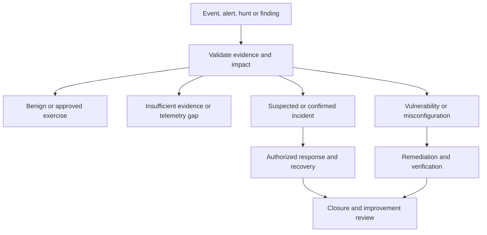

# Organizational Incident Management — Threats and Security Events

**Adoption status:** proposed lab process. The system owner must assign real authorities, approved communications, thresholds and reporting obligations before operational use. This is a practical workflow informed by [NIST SP 800-61 Rev. 3](https://csrc.nist.gov/pubs/sp/800/61/r3/final), not a replacement for the organization's incident policy. NIST's current guidance integrates response with CSF 2.0; the stage names below are this repository's working procedure.

## Roles and decision authority

| Role | Owns | Decision boundary |
| --- | --- | --- |
| SOC analyst / threat hunter | Validate telemetry, triage, evidence references and hypotheses | May investigate within assigned access and scope; recommends response |
| SOC lead / incident coordinator | Case priority, incident declaration under delegated policy, tasking and handoffs | Escalates when impact or authority exceeds delegation |
| Incident owner / system owner | Mission impact, response priorities and restoration decisions | Authorizes actions under the approved response plan |
| System / network / endpoint administrators | Approved configuration, isolation, remediation and restoration | Execute approved actions and record results/rollback |
| Forensic lead | Collection plan, acquisition integrity, custody and analytical review | Controls evidence handling under approved procedures |
| Vulnerability lead | Linked exposure findings, applicability and remediation follow-up | Does not treat a vulnerability as proof of compromise |
| ISSO / ISSM and designated risk authority | Security reporting, risk records and escalations | Formal risk acceptance stays with the authorized official/delegate |
| Privacy, legal, communications and mission representatives | Their organization's notification and disclosure decisions | Participate as required by the incident and governing policy |

One person can fill several lab roles, but record who reviewed consequential decisions. Use the [incident record](templates/incident-record.md) to identify the accountable owner, action executor, approver and stakeholders for each case.

## Triage and case routing

A case can have both an incident and a linked vulnerability. Keep their identifiers and closure criteria separate. A benign disposition still requires recorded evidence; an unknown disposition needs an owner and next review date.

## Illustrative priority criteria

| Priority | Example impact and evidence | Coordinator action |
| --- | --- | --- |
| P1 — Critical | Credible ongoing compromise with severe mission disruption or data impact | Invoke the organization's critical-incident path and delegated emergency authority |
| P2 — High | Corroborated compromise or significant exposure needing coordinated action | Assign an incident owner and response workstream |
| P3 — Moderate | Suspicious activity with limited observed impact or incomplete scope | Set a bounded investigation and reassess when evidence changes |
| P4 — Low / informational | Benign exercise, minor anomaly or improvement observation | Record disposition and route improvement tasks |

These examples are not mandatory response times. Record impact, confidence and business criticality separately. A single detection label or vulnerability score does not determine incident severity. Set acknowledgment, update, reporting and review times from the organization's actual policy, contract and command requirements; record the applicable rule and clock start.

## Step-by-step workflow

1. **Prepare:** Confirm contacts, on-call coverage, access, logging, evidence storage, clock synchronization, backups, product health and exercised response/rollback procedures. Track preparation gaps before an incident.
2. **Register intake:** Create a case ID, owner and receipt time. Preserve the source reference, original event/capture time, timezone, detection/search version and reporter. Check for related cases to avoid duplicate tasking.
3. **Validate the signal:** Confirm source authenticity, host identity, timestamp alignment, field extraction and telemetry health. Reproduce the query against a bounded approved scope. Preserve query text and job messages.
4. **Assess context:** Review known maintenance, changes and authorized exercises with their owners. In the named-pipe lab, an Atomic-generated name is expected test behavior; it does not identify an actual Cobalt Strike Beacon.
5. **Determine initial scope and impact:** Identify affected services, identities, data classes, network segments and operational constraints. Record what is observed, what is inferred and what remains unknown.
6. **Route and prioritize:** The coordinator records the disposition, priority, confidence, justification and next update time. Declare/escalate an incident through the delegated organizational process when warranted. Link exposure findings to the [vulnerability workflow](VULNERABILITY_MANAGEMENT.md).
7. **Preserve evidence:** Follow the collection plan before destructive changes where operationally feasible. Assign evidence IDs, record acquisition method/tool/version and hashes, protect originals, use working copies, and maintain custody/transfer records. Document any emergency action that changed evidence.
8. **Plan response:** Compare containment choices with mission impact and evidence needs. Identify exact targets, authorized executor, approval or preapproved runbook authority, preserved management access, rollback and validation criteria.
9. **Contain under authority:** Execute only the approved action and scope. Record start/end, operator, command/policy or console action, returned status, actual endpoint effect and failures. A console request is not proof of successful isolation. Preserve a route to manage and recover the endpoint.
10. **Investigate and remediate:** Test competing hypotheses. Determine affected scope, persistence, account exposure and entry path to the extent supported. Coordinate approved malware handling, eradication, patching, policy correction or credential changes with the relevant administrator. Preserve evidence before removal; do not execute unknown artifacts for this portfolio exercise.
11. **Recover and monitor:** Verify service function, security controls, logging, agent health, data integrity and changed credentials/policies where applicable. The owner authorizes restoration, including release from isolation. Observe for recurrence over an agreed period.
12. **Close and improve:** The accountable owner accepts closure evidence or records remaining risk and a follow-up owner. Complete the report, linked vulnerability statuses, lessons, detection changes, training actions and an approved retention/disposal plan. Reopen if new evidence changes the disposition.

## Approval record for consequential actions

| Action | Record before execution | Verify afterwards |
| --- | --- | --- |
| Host isolation or network block | Authority, exact target, mission impact, management access and rollback | The intended host is isolated; approved management/recovery access works |
| File quarantine/removal | Evidence acquisition decision, exact artifact and owner approval | Actual product outcome, remaining copies and business function |
| Account/session action | Correct identity, mission dependencies and authorized scope | Session/account state, recovery path and audit logs |
| Patch or control/policy change | Validated finding, change record, compatibility test and rollback | Effective configuration, service health and retest |
| External notification or evidence transfer | Authorized recipients, channel, handling and governing requirement | Delivery/receipt recorded without exposing sensitive details publicly |

Existing delegated emergency procedures can authorize an action without a new ad hoc approval; record that authority. This document itself grants none. AI output and reputation scores never authorize containment or disclosure.

## Communications and shift handoff

Issue updates through the approved incident channel at the owner-defined cadence and after material impact/scope changes. Use the [briefing template](templates/hunt-briefing.md) to state: what happened, affected scope, confidence, actions taken, current risk, decision required, owner and next update. Send neither raw evidence nor credentials in a routine status message.

At handoff, name the accepting analyst and time. Include case priority, current hypotheses, exact query/evidence references, completed and blocked tasks, approvals, change status, known gaps, communications due and next owner. Obtain acknowledgment; an unattended ticket assignment is not a complete handoff.

## Closure and measures

Close only when the disposition is supported, response/recovery is verified, the owner accepts residual issues, required notifications are recorded and open corrective actions have accountable owners. Keep an incident open or explicitly transfer responsibility if conditions are unmet.

Measure acknowledgment, triage, containment and recovery using defined timestamps; distinguish request time from effective-action time. Track collection gaps, repeat incidents, false-positive dispositions, reopened cases and overdue actions. Document exclusions and small-sample limits. Targets and actual results remain owner-defined/pending until observed.
