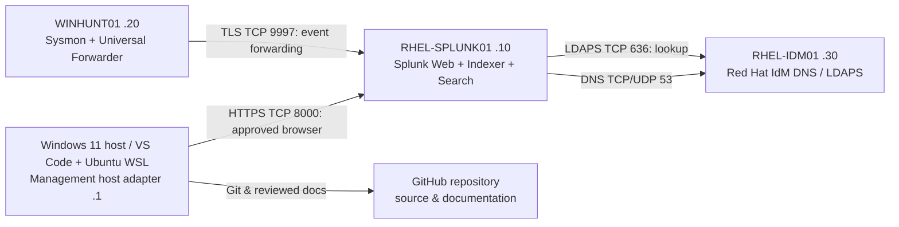
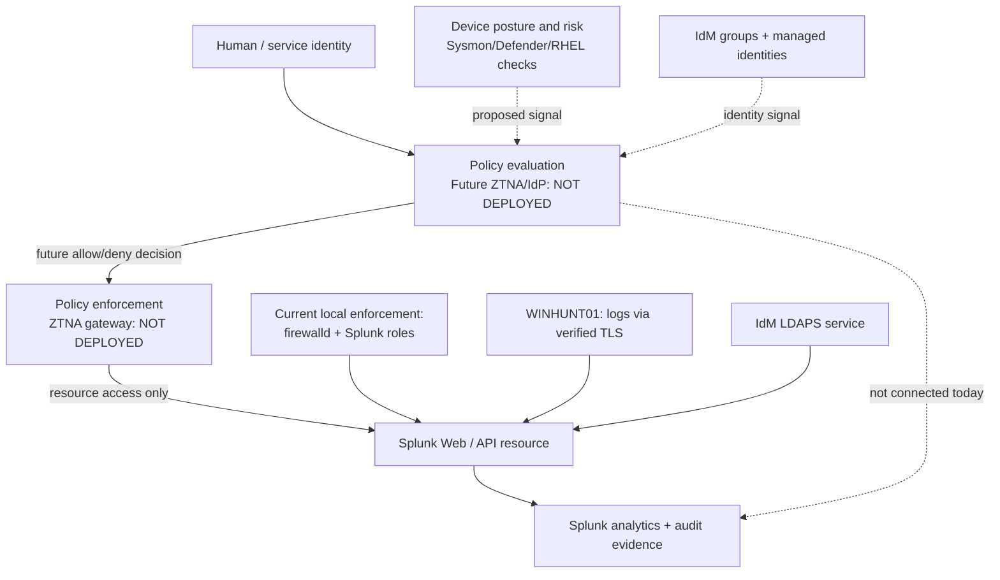

# 01 — Architecture, Resource Flows and Zero Trust Decisions

## Current documented three-VM architecture

All VM addresses are on VMware VMnet8 `172.25.250.0/24`; gateway `172.25.250.2`. The network provides NAT isolation from other networks **but does not automatically prevent lateral movement among VMnet8 peers**.

**Existing implementation statements require live verification.** The diagram illustrates the lab's documented intended data flows, not verified network captures or DoD compliance.

## Proposed phased Zero Trust architecture

This separates **design target** (dynamic policy decision point and enforcement point, MFA and device posture) from **current measures** (firewall rules, native LDAP role mapping, verified TLS and SIEM). Under NIST SP 800-207, a true policy engine and policy administrator decide and orchestrate requests across resources; simply labeling Splunk a PDP would be inaccurate.

## Trust boundaries and enforcement locations

| Boundary | Decision signal | Actual or proposed enforcement | Status |
| --- | --- | --- | --- |
| Human → Splunk Web | Group membership, authenticated session | Splunk RBAC; source-limited firewalld | Existing configuration, requires tests |
| Windows VM → indexer | Forwarder TLS certificate, network source | Splunk TLS receiver + host firewall | Configured source, requires tests |
| Splunk → directory | Trusted IdM CA, LDAP bind access | LDAPS server + Splunk LDAP role map | Documented source, requires tests |
| Data → index | Index + role permissions | Splunk role, index grants, retention | Documented source, requires tests |
| Device trust → app | Posture, MFA, identity risk | Approved IdP/ZTNA policy | **Not deployed** |
| Automation → endpoint | Explicit approvals and risk | Future policy administrator / SOAR | **Not deployed** |

## Migration priorities

Begin by shrinking allowed flows and identities around **one resource**: Splunk Web, not by declaring the whole VMnet8 subnet trusted. Preserve administrator console break-glass access. Record which services depend on DNS, IdM and updates before applying restrictive egress controls.

## Architecture acceptance criteria

- Resource-by-resource connectivity matrix, user role matrix and data sensitivity approved.
- Both allowed and denied accesses actually tested and logged.
- Recovery after policy change demonstrated.
- Optional MFA/device posture/ZTNA is marked absent until independently implemented and assessed.
